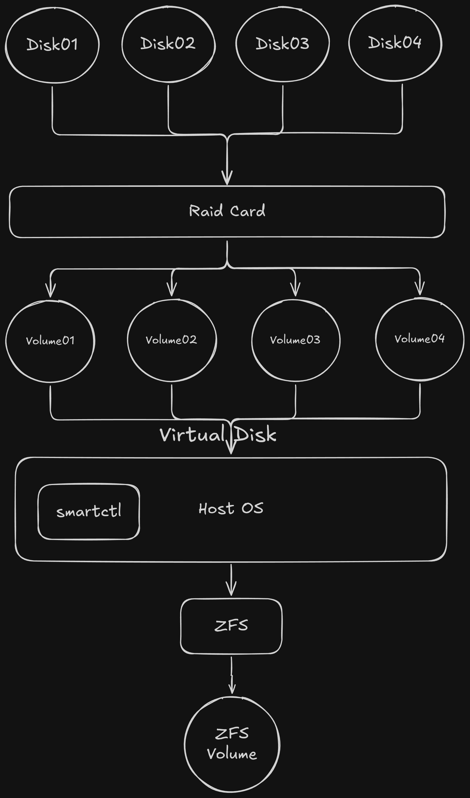
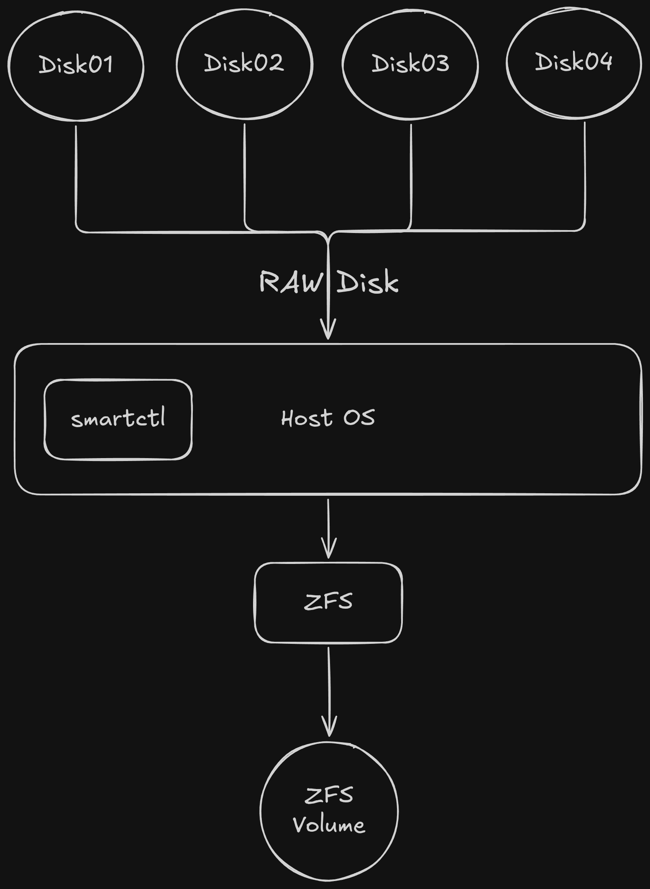

I just bought a Dell PowerEdge R720 to be my new home server. Used enterprise gear is a great deal, but it usually comes with a few "surprises". Mine came with a PERC H710 Mini RAID card, and I want to use ZFS. Spoiler: those two do not get along. In this post I share why a hardware RAID card is a bad match for ZFS, what IT mode is, and how I crossflashed the H710 Mini step by step.

<!-- truncate -->

## The situation

The R720 I got has a **PERC H710 Mini** sitting in the dedicated storage slot. It is a hardware RAID controller, and by default it wants to build the arrays for you.

But my plan is to use **ZFS** as my storage layer. So the RAID card needs to stop being a "RAID card" and become a dumb pipe that gives my disks to the OS as they are. The solution is to flash it to **IT mode**.

Before the how, let me explain the what and the why, because this is the part that confused me at first too.

## Some terms first

### What is a hardware RAID controller?

A hardware RAID controller is a card (or a chip on the motherboard) with its own processor, its own firmware, and usually its own cache (sometimes with a battery, called BBU). It sits between your disks and the operating system and does the RAID work itself: striping, mirroring, parity, rebuilds.

The OS never sees the individual disks. It only sees what the card presents: a **virtual disk** (also called a logical volume). You set this up in the card's BIOS / config utility, before the OS even boots.

Great for a classic setup like "ext4 or XFS on top of a RAID5". Not great when the filesystem wants to do all of that by itself.

### What is LSI?

LSI (now part of Broadcom) is the company that made most of the SAS/SATA controller chips used in server storage. A lot of "brand name" cards are actually LSI chips with a different sticker:

- Dell PERC = LSI MegaRAID / LSI SAS chips with Dell firmware
- IBM ServeRAID M-series, Cisco, Fujitsu, and so on = also LSI underneath

That is the reason crossflashing is possible. The H710 Mini is an LSI-based card, so we can replace Dell's firmware with plain LSI firmware.

### What is ZFS RAID?

ZFS is both a filesystem and a volume manager. It does RAID by itself in software, and calls it:

- **mirror** (like RAID1)
- **raidz1 / raidz2 / raidz3** (like RAID5 / 6 / "triple parity")

Because ZFS controls both the disks and the filesystem on top, it can do things a normal RAID card cannot: checksum every block, detect silent corruption, and **self-heal** by reading the good copy from another disk and repairing the bad one.

## Why hardware RAID and ZFS do not mix

ZFS wants to see the real disks. The more a RAID card hides, the more ZFS loses.

### Setup 1: RAID card, then ZFS (bad)



When you use a RAID card, you first go into the controller BIOS and create an array from your disks. The card then exposes a **volume** (a virtual disk) to the host OS. ZFS is then created on top of that virtual disk.

What goes wrong:

- **ZFS cannot see the physical disks.** It does not know which disk is dying, and it cannot manage redundancy per disk.
- **Self-healing is crippled.** If the card builds the mirror or parity, ZFS only sees one "disk". It can detect corruption through checksums, but it has no second copy of its own to repair from.
- **SMART is limited.** Behind a RAID card, `smartctl` needs vendor-specific flags (like `-d megaraid,N`) and the data is often incomplete.
- **Two caches that do not know each other.** The card has its own write cache, and ZFS relies on the guarantee that a flushed write is really on disk. If the card lies about flushes or loses its cache on power loss, ZFS consistency is at risk.
- **Error handling clashes.** The card has its own timeouts and retries. A dying disk can be held in a retry loop while ZFS just waits, with no idea what is happening.
- **You are locked to that card.** If the card dies, you need the same model and firmware to read your array again.

You might think "I will just make a single-disk RAID0 per disk to fake JBOD". It works on paper, but each disk is still wrapped by the card, so most of the problems above still apply.

### Setup 2: Raw disks (passthrough) to ZFS (good)



With an HBA (or a RAID card in IT mode), every physical disk is passed straight to the host OS. `smartctl` can read each disk directly, and ZFS gets **raw disks** that it manages 100% by itself: redundancy, checksums, self-healing, resilvering, everything.

As a bonus, your pool is portable. Move the disks to any other machine with an HBA, run `zpool import`, done.

## What is IT mode?

LSI controllers can run different firmware personalities:

| Mode | Full name | What it does |
|---|---|---|
| **IR** | Integrated RAID | The card does basic RAID (and Dell's PERC firmware goes even further, with full MegaRAID features) |
| **IT** | Initiator Target | The card only passes the disks through. No RAID, no virtual disks, the OS sees each disk as it is |

So **IT mode = "HBA mode"**. The card stops thinking about arrays and just gives you the disks.

According to the guide I followed, there are two nice side effects:

- **Better performance.** The queue depth goes up a lot. On the H310 Mini, for example, it goes from 25 with the stock Dell firmware to 600 with the LSI IT firmware. That helps especially with SSDs.
- **A simpler driver.** Stock Dell firmware uses the `megaraid_sas` driver. After flashing, the OS uses the much simpler `mpt3sas` driver, which also plays nicer with SMART.

One more thing: the H710 has cache (512 MB) and a battery. In IT mode **neither is used**, so don't worry about "losing" it. For ZFS that is actually what we want.

## Before you flash

All of this follows the amazing guides from [Fohdeesha](https://fohdeesha.com/docs/perc.html). Huge thanks to him and everyone who did the hard work on this. I am only sharing my own run of it, so please read the original too.

:::warning
Crossflashing can brick your card if you pick the wrong guide. The H710 Mini has multiple revisions (B0 and D1), and each has its own steps. Always check your revision first, and never pick "the closest one".
:::

Checklist from the guide:

1. **Only one LSI-based adapter** should be in the server. Pull the others.
2. In the **server BIOS**, disable:
   - Processor Settings > Virtualization Technology
   - Integrated Devices > SR-IOV Global Enable
   - Integrated Devices > I/OAT DMA Engine
3. Set **Boot Settings > Boot Mode** to **BIOS** (not UEFI). You can switch it back after you are done.
4. **Remove the RAID battery** from the card. IT firmware has no cache for the battery to back up, and in rare cases the battery held old Dell code in the card's RAM and made the flash painful.
5. **Pull all the drives** from the front hot-swap bays. They will not be touched, but having them connected can make the flash fail.
6. Download the **Dell PERC flashing ZIP** from the guide. It contains two ISOs: a **FreeDOS** live image and a **Debian** live image, both with all the tools included. Boot them through iDRAC virtual media or a flash drive (Rufus on Windows, `dd` on Linux). If you use Ventoy, boot the FreeDOS image in memdisk mode.

## Step by step

### 1. Check your card revision

Boot the server from the **FreeDOS ISO**, then run:

```text
info
```


It will show the card name and revision. For me it was a **PERC H710 Mini D1**, so I followed the [H710 D1 Mini guide](https://fohdeesha.com/docs/H710-D1.html). If yours says something else (H710 Mini B0, H710P, H310, and so on), go to the matching page from the [intro guide](https://fohdeesha.com/docs/perc.html).

The output should look like this:

```text
Product Name : PERC H710 Mini
ChipRevision : D1
SAS Address  : xxxx (will differ)
```

**Write down the SAS address** (screenshot it). We will program it back at the end. Not a disaster if you lose it, but it is easier to restore the original one.

Also note: R720 is a rackmount server, not a blade, so ignore the "Blade" versions of the guides.

### 2. Wipe the Dell firmware

Still in FreeDOS:

```text
D1CROSS
```

Follow the prompts. This wipes the flash on the card, removes all Dell firmware, and flashes the required SBR. If it finishes without errors, reboot into the Linux ISO:

```text
reboot
```

(Make the Linux live ISO ready to boot before you reboot.)

### 3. Boot the Linux live ISO

Login with `user` / `live`.

Tip: SSH into the live ISO so you can copy and paste commands instead of fighting the iDRAC console. Get the IP with:

```text
ipinfo
```


Then `ssh user@<that-ip>` with the same password `live`.

### 4. Flash the IT firmware

Become root:

```text
sudo su -
```

Run the flashing script for the H710 D1:

```text
D1-H710
```

It does everything automatically. If you get no errors, we are almost done.

:::note
After the first crossflash, the **very first reboot** can cause a kernel panic. This is expected, the guide author thinks iDRAC does not let go of something. Let it reboot by itself or force a reboot from iDRAC, then boot the Linux live ISO again and it will be fine.
:::

### 5. Program the SAS address back
 
Back in the live Linux image, as root, restore the SAS address you wrote down in step 1:
 
```text
sudo su -
setsas xxxxxxxxxxxxxxxx
```
 
:::note
Replace `xxxxxxxxxxxxxxxx` with **your own SAS address** that you saved earlier from the `info` output (16 characters, no dashes). Don't copy-paste the placeholder, and don't use someone else's address.
:::


Then verify:

```text
info
```

You should see something like this:

```text
Controller                     : SAS2308_2(D1)
Firmware Product ID            : 0x2214 (IT)
Firmware Version               : 20.00.07.00
NVDATA Vendor                  : LSI
NVDATA Product ID              : SAS9207-8i
Board Name                     : SAS9207-8i
```


`(IT)` in the firmware product ID is what we want. Your PERC H710 Mini is now an LSI SAS9207-8i HBA.

### 6. Optional: boot images

Only needed if you want to **boot from drives on this card**. It adds the "press ... to enter LSI config" screen and can add up to 2 minutes to boot time with many drives, so skip it if you don't need it.

```text
flashboot /root/Bootloaders/mptsas2.rom     # legacy BIOS boot
flashboot /root/Bootloaders/x64sas2.rom     # UEFI boot
```

### 7. Clean up

Remove the live images, put the server settings back (Virtualization Technology, SR-IOV if you use it, boot mode back to UEFI if you used it before), put the drives back in, and boot your normal OS.

## Optional: fix the fan speed

iDRAC does not expect a PERC slot to run LSI firmware, so it can no longer read drive temperatures. On some servers this triggers the `PCI3018` event in the Lifecycle Log and the fans lock to a static ~30%, as a failsafe.

If you get this, you can disable the `ThirdPartyPCIFanResponse` feature. With `racadm` over SSH:

```text
racadm set system.thermalsettings.ThirdPartyPCIFanResponse 0
```

Check the current value with `racadm get system.thermalsettings.ThirdPartyPCIFanResponse`. The guide also has an `ipmitool` version that is built into the Linux live ISO.

:::warning
Use this at your own risk. You are changing thermal behaviour, so if your server lives in a hot room, maybe leave it alone and keep an eye on your disk temperatures instead.
:::

## Reverting to stock Dell firmware

Changed your mind? Boot the FreeDOS image again and run:

```text
D1REVERT
```

Reboot, and you are back on the latest stock Dell PERC firmware.

## Verify on the OS

Once your OS is up, the disks should now look like normal disks. A quick check:

```bash
lsblk
lspci | grep -i lsi
smartctl -a /dev/sda
```

If `smartctl` works directly on the device without any `-d megaraid,N` flag, you are good. Now the disks are ready for `zpool create`.

## Wrap up

The R720 is a great homelab server, but the PERC H710 Mini is a RAID card, and ZFS does not want a RAID card in the middle. Crossflashing it to IT mode takes maybe 30 minutes, costs nothing, and turns it into a proper HBA:

- every disk is visible to the OS, with full SMART
- ZFS manages redundancy and self-healing by itself
- no RAID cache or battery to get in the way
- easier to recover, since the pool can move to any other HBA

Next post, I will build the ZFS pool on this thing. Stay tuned.

## References

- [Fohdeesha: H310/H710/H710P/H810 Mini & Full Size IT Crossflashing](https://fohdeesha.com/docs/perc.html)
- [Fohdeesha: H710 D1 Mini](https://fohdeesha.com/docs/H710-D1.html)